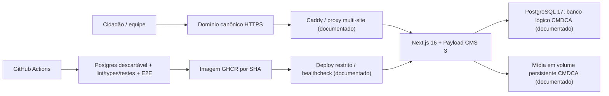

> Fotografia de 04/11/2026. Estado atual: [RELATORIO-FINAL.md](RELATORIO-FINAL.md) e [RISCOS.md](RISCOS.md).

# Arquitetura atual declarada e fronteiras verificadas

**Fonte:** `src/payload.config.ts`, `next.config.ts`, `README.md`, `DEPLOY.md`, `deploy.yml` e ADRs 0002/0003. A inspeção confirma a **configuração declarada no repositório**, não a topologia Docker/VPS executando no instante da leitura. Sem SSH, não se verificou volumes, replicação, tenants, snapshots, monitor, portas ou digest.

**Estrutura de aplicação:** páginas SSR/ISR com dados Payload; CMS/admin e APIs no mesmo Next. A API local pública define `overrideAccess:false` via `getPayloadClient`. Mídias são servidas pelo Payload com controles, versão antiga de S3/R2 sob `S3_BUCKET`. `graphql.disable=true`; migrations em `prodMigrations`, `push:false`. `revalidatePath` acionado por hooks editoriais. Em CI, `quality.yml` usa serviço PostgreSQL efêmero; `deploy.yml` publica imagem imutável por SHA e solicita deploy de VPS.

**Legado em paralelo:** projeto Vercel `cmdca`, deployment READY antigo e login `cmdca.vercel.app/admin` ainda acessível. O banco/media desse deployment, contas e acesso de escrita **não** foram verificados. Não desativar até garantir export e rollback.

**Riscos de operação:** SPOF de uma VPS, possível incoerência de docs antigas, off-site pendente conforme HANDOFF e ausência de prova independente de recuperação. Não introduzir microserviços/Kubernetes ou dependência nova para resolver lacunas que exigem teste.

## Revisão do repositório privado da plataforma
A integração GitHub concedeu **leitura** do repositório privado `vhonorato02/vps-platform` (scripts e Compose) nesta rodada. O código confirma: `caddy-docker-proxy` atrás de socket-proxy somente leitura, Postgres `17-alpine` em rede interna, banco por site, Dockge em interface local, fluxo SSH de deploy com `forced-command`, backup local restic e timers de backup/restauração. Isso melhora a evidência de **arquitetura projetada**, mas não mostra se essas configurações estão aplicadas no host. Nenhum segredo da plataforma foi copiado para este documento público. Fontes privadas: `compose.yml`, `caddy/Caddyfile`, `bin/gh-deploy`, `scripts/backup.sh`, `scripts/restore-test.sh`, `scripts/deploy.sh`.
